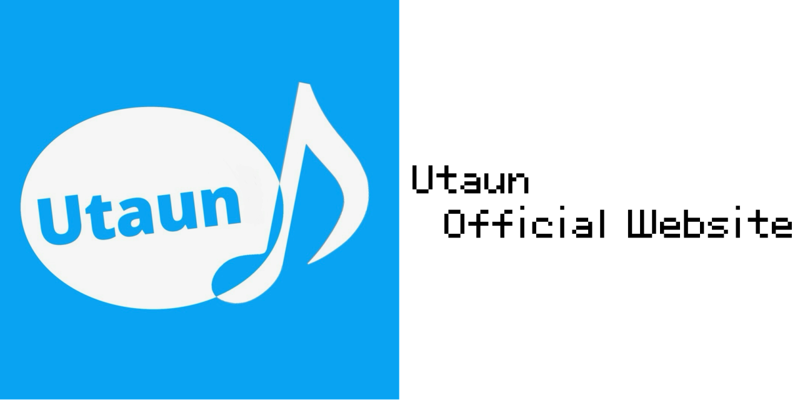

# What is Utaun?

Utaun is a Windows application that generates UTAU CV voicebanks solely through inanimate composite sine wave modeling (CSM synthesis).  

**• Zero Human Voice Needed: Create unique machinery or robotic singing voices completely from scratch without recording your own voice.**  

**• Effortless DTM Integration: Supports automatic ZIP generation and direct export to UTAU and OpenUTAU folder directories.**  

**• 100% Inspired by 足立レイ (Adachi Rei): Utilizes the exact same conceptual approach to shape clear, crisp artificial vowels using pure sine waves.**  
 
 
Click here for the official Discord server!

Utaun Official Website! 

 
 
  
■ Rules for Code Rewriting and Plugin Creation

・**How to rewrite** To rewrite code, download the '.py' files from GitHub and experiment in your local environment such as your PC.
・Do not distribute modified cores or plugins to the general public without official permission.

・When you say 'I rewrote it like this!' or 'I made a plugin!', please feel free to share actual execution screens (screenshots or videos) on the official Discord server!

・**Important** If you want to build and officially release modified source code into app formats (binary formats) such as '.exe', '.app', or Linux executables, it will be decided through discussion on the official Discord server in advance. If several members gather and decide there, the build and release will proceed without waiting for other absent members to join (to prioritize development speed).

⚠️ Warning

The author and project affiliates assume no responsibility for 'Utaun' downloaded from unofficial locations. For safety, please always download from the official GitHub (or official site links).
